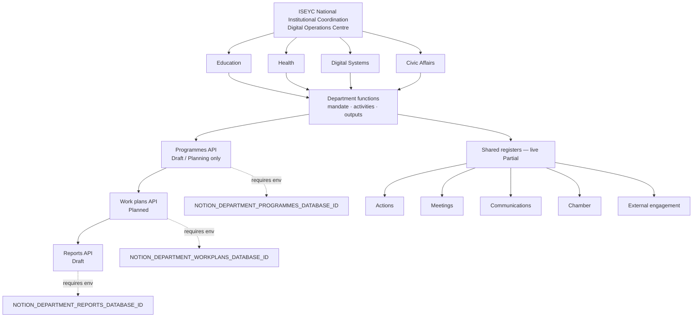

# ISEYC departmental operating architecture

Code-level diagram (not a generated image). Reflects the implementation on `feat/doc-operational-workflows`.

**Live Partial:** Actions, Meetings, Communications, Chamber, External engagement.  
**Implemented, unconfigured until env + share:** Programmes, Work plans, Reports.  
**Disabled:** Approval, publication, dispatch, formal closure, appointment-based authority.
